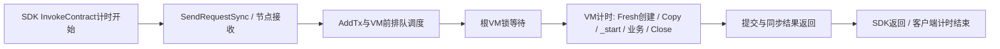

# Step-20：端到端性能归因

2026-10-23，Asia/Shanghai。**已完成历史审计、原二进制小样本复现，以及首个正式批次的部分采集；因RSS触发预设阈值停止，未完成3个独立批次，未执行新详细追踪或默认池R1/R2。**没有提高资源上限继续采样，没有增加锁或修改优化算法。所有自启节点和客户端均已停止。

## 最终问题的当前答案

1. **Step-17的Copy节省确实位于端到端请求关键路径。**它是同步Fresh，不是后台预填池；SDK等待该交易的提交结果。不能用Step-19低负载后台补池解释Step-17的全部端到端现象。
2. **已有详细诊断能定位“额外时间落在哪里”，不能证明“由Copy造成”。**重新从原始trace按节点自身单调钟核算，2026-10-19两批compute的AddTx返回→VM入口平均多1.686/2.573ms，足以抵消VM段约0.640/0.674ms节省；该窗口还未细分proposer/调度等环节，不能直接命名为纯共识等待。
3. **本轮新的部分样本也出现均值抵消。**88对中VM平均省0.273ms，客户端平均慢1.148ms，VM窗口之外的未细分残差平均增加1.422ms。这是同对、同一总窗口的可加核算；新批次没有详细阶段打点，不能把这1.422ms直接归到旧批次发现的AddTx→VM窗口。
4. **默认池取消100ms后Copy是否减少等待/改善客户端，仍未验证。**默认池Store并发/异步关闭/退出问题未获解决，本轮又触发同步Fresh的资源门槛，不能通过原TestInvoke的约10倍差距替代R1/R2端到端实验。

## 原路径与计时，避免混淆



STEP17 invoke_ns在根锁获得后开始，不含锁等待、NewRuntimeInstance/冷模板准备；客户端包含。同步Fresh创建和Close位于调用线程，不启动后台grow worker。详细审计见AUDIT.md。

SDK-Go/v2 v2.4.0 `InvokeContract(...,60,true)`在当前配置走`SendRequestSync`；node_only_async默认false，故配置中的retry_interval=5不是本路径已生效的SDK 5ms轮询。节点等待提交结果dispatcher，不只是收交易ACK。不能以旧README一句“SDK查询”作为轮询负收益解释。

## 本轮实际执行、停止与样本

计划：先3对热请求的smoke，再compute三批各100对；每端点每批1次冷调用+5次预热，热请求逐对随机先后，无业务Sleep，按原Step-17 workers=1路径。不是8合约/4并发全量重跑。

- smoke完成：3对热调用，含冷/预热共18条响应。
- low-a计划100对，触发RSS软阈值后停止：Baseline88条、Copy89条热响应，**88完整配对+1条未配对响应**均保留。含冷/预热共189条响应。
- 中止发生在下一项业务job写入客户端管道后的资源采样，尚未记录响应；无法确认SDK是否已开始调用/节点是否接受，TxID未捕获。没有匹配到额外已完成VM事件。该项标为resource-censored，不算失败或成功；剩余22项计划请求未发出。
- 所有207条已保存响应（两轮含预热/冷）业务返回成功、Gas=106028、同步响应有块高。没有采集到明确失败或超时响应，不将“已完成响应100%成功”说成所有计划请求100%成功。
- low-b、low-c、新trace、默认池R1/R2与并发均未启动；execution_status.csv明确not_run，不以0填充性能。

配对只取88个完整对，89条Copy的全部分布另在summary.csv；没有删除未配对样本。下面都是**资源中止批次的描述值，不能宣称稳定负收益或完成三批验证**：

| 指标，单位ms | Baseline Mean / P50 / P95，n=88 | Copy Mean / P50 / P95，n=88 |
|---|---|---|
| SDK客户端 | 37.914 / 38.845 / 49.355 | 39.062 / 41.228 / 49.685 |
| 所有根VM尝试总时间 | 4.622 / 4.157 / 7.369 | 4.348 / 3.807 / 6.513 |
| 创建至S1 | 2.396 / 2.117 / 3.983 | 1.945 / 1.715 / 3.409 |
| Copy自身 | 0 / 0 / 0 | 1.492 / 1.307 / 2.645 |

原始单笔NewInstance子窗口没有独立采集；S1含NewInstance及必要Copy。s2−s1为WASI+_start等合并成本，不标成纯_start。CallMethod单独耗时本路径缺失，S3后残差也不标成纯业务。

同对节省定义Baseline−Copy，平均值可相加：

| 范围 | 平均节省ms |
|---|---:|
| 客户端总时间 | -1.148336 |
| 根VM总时间 | +0.273265 |
| 客户端减去根VM的未细分残差 | -1.421601 |

配对中位节省则分别为客户端+0.228ms、VM+0.380ms；与均值方向不同。不能混用平均值、两个总体中位数差及配对中位数，也不能累加各阶段中位数。未给中止样本做CI或显著性结论。

## 资源门槛与停止证据

| low-a资源，离散采样 | Baseline | Copy |
|---|---:|---:|
| 首个热窗口RSS MiB | 1572.47 | 1575.41 |
| 最后/采样峰值RSS MiB | 2558.71 | **2564.71** |
| 线程采样峰值 | 27 | 27 |

每节点MemoryMax=3GiB、RSS软限2560MiB、TasksMax=256、线程软限220、RuntimeMax=120s、单SDK请求外部watchdog15s、停止超时5s。Copy先触发RSS软限；没有等到OOM。CPU ticks及逻辑核百分比、虚拟地址空间分别保存于resource_summary.csv和原始JSONL，不将虚拟地址空间说成物理内存。

两个模式RSS都增长约986–989MiB，方向一致；只有一个compute模板，每个进程只准备一次，原source_sha/config_id/template_sha/copy_bytes/range_count与Step-17一致，热样本没有反复建模板的证据。不能把GB级增长直接归为Copy模板，也未用native分配器/堆采样证明全部来自Store、数据库cache或特定分配器。本轮遵循停止条件，不实施内存轮换或算法修补后继续跑。

## 历史重执行与后续详细诊断的重算

原Step-17的5248条热客户端响应对应6008次根VM执行；382个TxID有2–4次根执行，均在workers=4组。原summary取最后一次根Invoke，不代表客户端总执行成本；本轮保留每Tx总root执行时间及每次root数据，exchange子调用不与根时间重复相加。

原workers=1、已有Step-19详细trace的144条以及本轮207条已保存响应，均只观察到一次根VM执行。新fresh Instance ID均唯一。故重执行不能解释本次部分单客户端样本的额外残差，但会影响原Step-17并发结果的解释。

旧trace重算只用节点进程内CLOCK_MONOTONIC差值、客户端自身time.Since。客户端总时长减节点RPC时长得到“外部未细分残差”；**没有直接相减跨进程时间戳**。客户端发送→节点接收的单向时间、RPC返回→客户端收到的独立单向时间继续标为缺失。

旧两批每批30完整对，以下为Baseline−Copy的**平均**节省，不替代原配对中位数及跨零CI：

| 阶段，ms | A | B |
|---|---:|---:|
| AddTx返回→VM入口 | -1.686248 | -2.573300 |
| 入口→根锁获得，含trace输出 | +0.001394 | -0.002621 |
| 获锁→VM结束，详细trace窗口 | +0.640076 | +0.674208 |
| VM结束→PutBlock返回 | -0.352311 | +1.226269 |
| SDK客户端总时长 | -1.373789 | -0.625937 |

其余相邻节点窗口及外部残差见historical_stage_accounting.csv，逐对/均值严格相加。原报告使用client_mono_ns总窗，这里使用SDK elapsed，二者在边界上有微秒差异，故末列与旧mean_accounting略有不同，未改写旧数据。

两批主要额外时间在VM之前，VM后窗口B反而更快，所以“提前执行完必然被同一提交时刻吸收”没有得到证实。两个独立链的出块相位、闭环到达时刻及调度状态可能不同，均为尚未控制的候选因素；没有证明Copy导致proposer排队变差。

## 默认池阶段的缺失与最小后续

100ms位于`step-19-reuse-reproduction/smoke.py:120`，业务返回后再Sleep；Step-17本来就没有这项Sleep。remove-100ms.patch仅删除这一行，旧脚本没有覆盖，**该diff未被执行为R1/R2实验**。

默认池同Store的后台创建、Call、异步Close可以重叠，退出不等待in-flight；仅客户端串行并不能排除后台并发。现有Go race不能验证native容器/引用竞争。按安全约束不启动默认池单客户端或并发，也不添加全局锁伪装原路径。

下一轮最小工作：

1. 先查明当前单合约RSS增长的所有权与回收边界，按同条件完成有界回收检查；不以无限抬高限额完成三批。
2. 资源门槛通过后，补齐相同原路径的三个独立批次，再对最少合约做低开销版/详细版分离追踪；在AddTx→VM补取交易、proposer调度入口，区分真正根锁等待、CallMethod、Close。
3. 默认池需先验证Store所有权/worker退休/在途回收。纯channel等待必须紧贴`instance = <-p.instances`前后，用同进程time.Now/time.Since取时、接收后输出；GetInstance总耗时另记，禁止两者混为一项。
4. 创建事件用pool+instance ID关联实际借出TxID，按同进程单调时间桶统计每秒成功创建/队列库存。客户端完成率、VM等效TPS、独立提交窗口TPS分列；当前仅有同步响应块高，未独立扫描账本窗口，不能伪造提交TPS。

缺失指标清单见missing_metrics.csv，未验证项不得标pass。

## 环境、执行与复核

独立工作树`.worktrees/cvw-step20`，分支`experiment/step-20-e2e-performance-attribution`，基于a47ae2f。实际低日志节点及客户端完全复用Step-17保存binary，没有重编或改算法；哈希、源版本、native、配置及完整启动命令见environment.json、*-command.json。仅隔离端口27801/27802、P2P28801/28802及路径变化；两个账本从已停机Step-17 baseline独立复制，无硬链接。链ID、单节点TBFT、20ms出块、SDK/API、GOMAXPROCS=4、artifact与输入不变，三个原Step-17子环境开关保留。

已实际运行：

```bash
python3 -B run.py --kind low --batch smoke --pairs 3
python3 -B run.py --kind low --batch a --pairs 100
# 第二条触发RSS停止；没有执行b/c、trace或默认池。
```

只读重算新旧数据（不启动节点）：

```bash
python3 -B CVW/experiments/instance-lifecycle/step-20-e2e-performance-attribution/analyze.py
```

run.py拒绝覆盖同名请求/日志；资源已触发，本次不要直接重跑或换标签扩测。停止只针对自有systemd单元/客户端，不操作原Step-17节点及正式生产。回退无需改生产代码；四个Step-20已启动节点单元均停止。

原始client JSONL、节点stdout、资源JSONL、截断状态和待定请求都保留。samples.csv不删未配对热响应；matched_summary.csv/paired_effects.csv仅完整对；vm_invocations.csv保留所有root attempts；historical_same_process_stages.csv及historical_stage_accounting.csv为旧trace重算。日志及配置在本机network目录，账本/证书/密钥不纳入实验提交。

命名说明：本目录由原E20统一更名，详见NAMING.md；原始日志、执行命令及结果未改写。后续实验统一使用`step-N`前缀。
