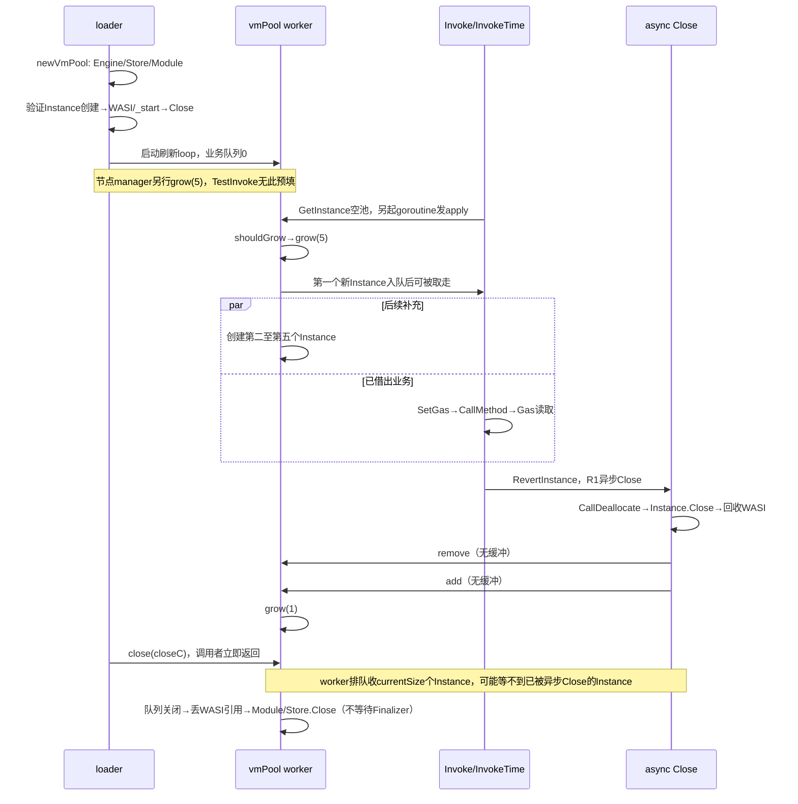

# 实例池完整生命周期

行号`V`为[evidence/current](evidence/current/)，`A`为[evidence/step21a](evidence/step21a/)。`V`是当前脏工作区，`A`是历史实验源码，不能互相替换。原容量修复准确diff见[capacity-fix.patch](evidence/capacity-fix.patch)。

图中par是原实现允许发生的时间区间重叠，不是本轮执行/许可的并发验证。

| 路径 | 当前源码 | 关键行为 |
|---|---|---|
| newVmPool | V/vm_pool.go:1028–1072 | 一个Store/Module；验证Instance不入业务库存，启动一条loop |
| 节点加载 | V/vm_instances_manager.go:107–113 | newVmPool后调用grow(5)，再缓存pool；不能把节点预填当TestInvoke初态 |
| 获取 | V/vm_pool.go:628–664 | channel先非阻塞接收；空池启动goroutine向apply发送，调用者阻塞接收，无取消/closed检查 |
| Invoke | V/runtime.go:44、87–94、124；InvokeTime:213、262–269、309 | 两者root/child实际均GetInstance并defer Revert；没有每次同步NewInstance |
| CallMethod | V/sim_context.go:76–191 | runtime函数→参数序列化→allocate→memory写入→业务导出函数；Gas设置/读取在runtime外围 |
| 归还 | V/vm_pool.go:667–683 | 当前`if true`强制Fresh丢弃；历史实验R0才走归还队列，保留错误丢弃规则 |
| 回收 | V/vm_pool.go:693–713 | 含guest deallocate；每次R1独立goroutine，Close后remove再add |
| grow | V/vm_pool.go:1175–1192 | worker同步逐个创建/发送，忽略创建error，未统一容量检查 |
| 周期维护 | V/vm_pool.go:1077–1147 | apply/refresh/add/reset调用grow；timer12小时不控制每次替补时机 |
| close/reset | V/vm_pool.go:1112–1140、1333–1340 | close只关信号，没有join；reset用同worker排空再建队列 |

## “只有一个grow协程”的准确边界

正常worker路径每池一条刷新loop，grow内部也没有并发创建。但不能扩大成“整个池只有一个创建入口”：manager在loop已启动后同步grow；`NewInstance`可直接newInstanceFromModule（V/vm_pool.go:686–688），还有NewInstanceFromByteCode入口。当前Invoke里的直接创建已注释，不代表这些方法永远不可调用。跨合约的不同池另有worker。异步Close可同时有多个。

worker的单线程执行也不能推出与借出Invoke串行：每个实例入队后消费者立即获得，worker继续创建其余实例。Step21A现场正是这个窗口。`newInstanceTime`等统计和currentSize混用atomic/普通读取也不构成native所有权同步。

## 控制通道和退出缺陷

`applySignalC/addInstanceC/removeInstanceC/resetC`均无缓冲，只有worker接收。一次GetInstance空池触发的apply与某次R1的remove/add独立，**没有同一需求票据或去重机制**。apply满足min后grow5，随后每次add还grow1，因此是重复供给请求风险，不是证明每次都重复增长。

可由源码直接构造的等待环：

1. **满队列入池**：原grow不统一检查max，worker在`p.instances <- instance`挂住，无法接收任何控制信号或close。历史Step21已保存真实失败；本轮不复现。
2. **关闭等丢弃对象**：currentSize包含借出Instance，R1异步Close后还未发送remove；若worker先进入close/reset，仍按旧计数从queue接收，那个Instance已销毁不会归队，remove发送又等worker返回select，形成等待环。不是必然发生，但路径明确。
3. **外部在途Invoke**：没有拒绝新acquire的closing状态、全体Invoke计数、等待者取消；关闭队列后GetInstance可能读nil并解引用，归还可能向已关闭channel发送。R1的延迟add/remove也可能永久等待。
4. **WASI/Finalizer**：清空freelist不等于同步释放，module/store Close不等待native Finalizer完成。不能笼统声称Store.Close后实际底层Store必已释放，Rc还可能持有；已足够说明退出协议不完整。
5. **错误处理**：newVmPool首次newInstance error未先检查便访问instance，grow也忽略error；失败可能导致nil访问或计数失配，不能只解决成功路径容量。

历史A版本新增`step21Tasks`、barrier、done，以及测试结束后的`step21Quiesce`（A/step21_experiment_test.go:52–91）。对“停止提交新Invoke后的封闭测试套件”可检测维护排空/worker退出；并未证明开放节点在途调用、native Finalizer和WASI资源已全join。满队列仍能阻塞barrier。守卫退出用os.Exit，defer不运行，不能计作正常资源回收。

## 容量补丁的运行期影响

`dc4d63b→c6addbf`在grow增加max-currentSize裁剪，A/vm_pool.go:1220–1231按环境选原/容量路径。min5/max10/grow5、channel10、单worker、GetInstance、业务计时及R1异步顺序没有直接改变；但是所有进入grow的请求都受新上界影响，可能少创建、提前return，改变库存、等待、后台工作量及稳态供给。

currentSize包含借出和待remove对象，不等于len(queue)。原shouldGrow里的一部分上界不能替代所有add/reset/grow入口的统一检查。容量补丁避免一类溢出，却不修Store共享、Finalizer、在途关闭等待环。旧短业务10–15倍只能称容量修复版结果；量化补丁的独立影响需要新的安全配对，当前缺失。
