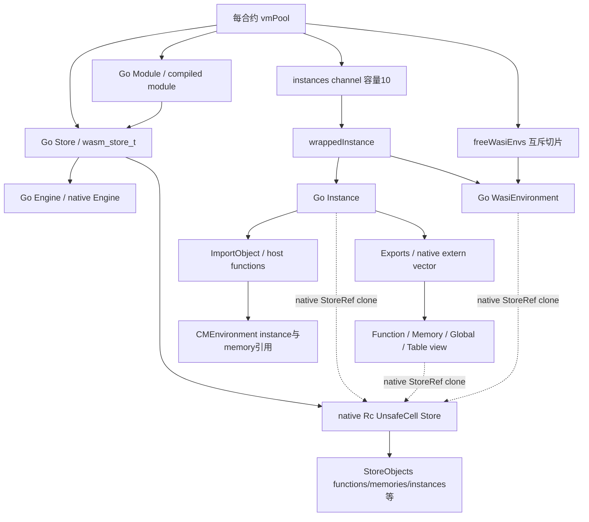

# 对象所有权和共享关系

以下`V`表示[evidence/current](evidence/current/)，即主工作区VM module的冻结快照；`N`表示[evidence/native-0910740](evidence/native-0910740/)，即本地native仓库`origin/chainmaker/v6.0.1@091074013fa056df0c6502262eae425927272e10`。所有行号以快照为准，哈希见[snapshot-manifest.json](evidence/snapshot-manifest.json)。native候选源码与so的精确构建映射尚未认证。

虚线是native共享引用，不表示独立Store。Module在Go层持有Store；其native结构是编译模块，不能据图推定native Module持有同一种Rc。Engine共享也不能代替Store所有权管理。

| 对象 | 创建/持有/释放 | 源码依据 |
|---|---|---|
| Store | `newVmPool`创建一个，`vmPool.store`持有，Module也引用；pool close分支手动Close，另有Go Finalizer | V/vm_pool.go:575–578、1028–1047、1126–1127；V/wasmer-go/store.go:20–61 |
| Module | 使用该Store编译并由pool保存；Go Module.store回指；close及Finalizer可删native handle | V/vm_pool.go:1035、1047；V/wasmer-go/module.go:56–61、106–121、287起 |
| Instance | `wrappedInstance.wasmInstance`持有；队列→借出Invoke→Revert转交异步关闭；Close后该字段nil | V/vm_pool.go:608–617、1238–1318、693–713；V/wasmer-go/instance.go:7–14、37–70、137起 |
| Memory | Exports返回借用wrapper，经Extern owner链保活Exports；Data返回native内存视图，不是Go拷贝；失效后slice不可用 | V/wasmer-go/extern.go:134起；memory.go:17–33、95起；V/sim_context.go:160–169 |
| Function | Exports的borrowed Function持有owner链；host函数有Go注册表、store/env引用；独立拥有的wrapper有Finalizer | V/wasmer-go/function.go:34–60、86–103、154起、354–400；exports.go:84起 |
| WASI Env | 创建时绑定Store；wrappedInstance使用，Close后放回池freelist；cap超限丢Go引用，GC可能删除；pool关闭清空freelist | V/vm_pool.go:715–760、1121–1125；V/wasmer-go/wasi.go:265–287；N/lib/c-api/src/wasm_c_api/wasi/mod.rs:323–380 |
| ImportObject | Instance持有，关闭时清空map及destroy native vector；host函数可能因Store中对象尚存而延后释放 | V/wasmer-go/instance.go:12、65–69、145起；import_object.go:105起；function.go:51–58 |

## 创建、执行和关闭接触的共享对象

`newInstanceFromModule`不新建Store：WASI Finalize、GenerateImportObject、GetImports、wasmergo.NewInstance及WASI Initialize都使用`p.store`（V/vm_pool.go:1249–1275）；`NewInstance`绑定层实际传`module.store.Inner()`（V/wasmer-go/instance.go:40–46）。native instance保存`store.inner.clone()`（N/instance.rs:96–99），不是深拷贝。

`exportFunc.Call`经`Function.Native`进入`wasm_func_call`（V/function.go:255–307）。native先clone共享StoreRef、取得StoreMut，再调函数（N/externals/function.rs:212–229）；涉及Store对象、目标Instance的VM状态、memory/global/table/Gas及导入host/WASI状态，具体业务触及哪些对象取决于WASM和回调。函数调用不只访问局部Function handle。Gas读写本身也为native调用（V/instance.go:79–90）。

`CloseInstance`先执行guest deallocate（含SetGasLimit与导出函数调用），再删除exports/imports/Instance，最后归还WASI（V/vm_pool.go:693–713；V/sim_context.go:202–211）。它不是纯Go资源清理。不同Instance的Close也会操作同一Store的引用计数；`wasi_env_delete`还会取得StoreMut并on_exit（N/wasi/mod.rs:376–380）。

`wasiMu`只保护freelist切片，hostFunctions的RWMutex只保护Go注册表；两者都不覆盖native Store。Env在Go切片意义上一次只分配给一个wrappedInstance，但Instance handle删除不证明Store内部WASI状态、线程和旧绑定全部消失，重复Initialize语义与资源回收仍需单独核实。

## 保活和失效风险

1. `Store.Close`、`Module.Close`、`Instance.Close`主要关闭Finalizer并delete，未普遍清空native指针/建立once状态；重复Close及Close与访问并发不受保护。外层wrappedInstance设nil仅对单所有者路径有效。
2. Go Finalizer不能保证在Store所有者线程运行。WASI Finalizer直接`wasi_env_delete`，不经过Step21A guard；host Function、Exports、Memory等Finalizer也可能执行native删除。仅禁止业务goroutine重叠不能覆盖这些路径。
3. `instance.go:100–128`已有保活风险说明，安全helper被注释掉。Function `_ownedBy`可保活Exports而不等于保活Go Instance；`Function.Native`调用后KeepAlive的是参数/结果，并没有完整Instance保活协议。本轮不据此宣称特定调用已早释放；需要显式所有者和KeepAlive范围审计。
4. `newVmPool`把验证Instance的Memory wrapper保存为`initialMemory`后关闭验证Instance（V/vm_pool.go:1061–1067）。wrapper的Exports native vector已删除，继续使用该wrapper存在悬空handle风险；当前生产路径搜索只见声明/赋值，没有发现再次解引用。不能把此静态风险写成现场UAF。
5. `maybeNewErrorFromWasmer`短时LockOSThread仅保护一次操作及线程局部错误读取（V/error.go:41–50），没有固定整个Store生命周期，也没有跨goroutine互斥。

共享Store本身不是native Bug证明。问题在于本实现没有满足共享可变Store及非原子引用计数的访问/销毁约束；已保存证据足以停止相应并发验证。

补充关闭细节：`V/wasmer-go/instance.go:137–146`在关闭前后两次调用Exports.Close。不能直接定性为二次free：候选native `N/lib/c-api/src/wasm_c_api/macros.rs:83起、206起`的vector delete通过take清空size/data；重复删除空vector可无效。仍需避免同时Close及用已失效wrapper访问，Instance native handle自身没有置nil/once保障。此处本轮未运行Go绑定重复关闭验证。
