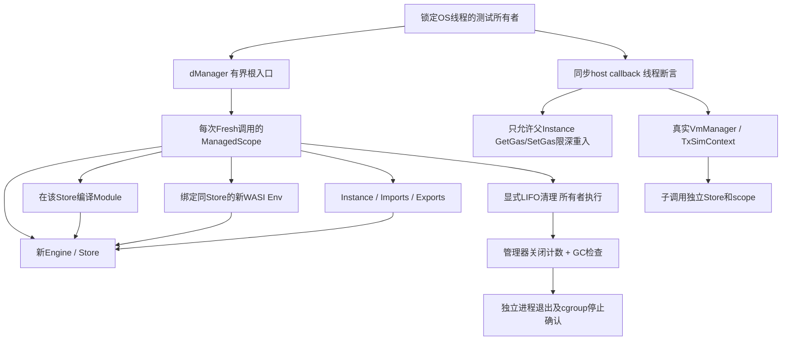

# 对象、线程与关闭模型

本轮选型比较见[DESIGN](DESIGN.md)。源码均在独立复制模块[source/vm](source/vm/)，原生产module及Step21B/C文件不改。基本模型不是全局VM锁，而是**单一native所有者、没有异步池的串行执行协议**，其性能限制明确接受。

Module不跨Store分享：`dCompile`原样提取21C opcode/function Gas maps、middleware及max512页配置；创建新Engine/Store后在它上面编译。`wasmergo.NewInstance`仍传`module.store.Inner()`，恰好就是本次新Store。host函数、WASI Finalize/import/Initialize都用该Store，Env不跨Store回收。这规避了“新建Store变量但NewInstance仍使用旧module.store”的陷阱。

R1每调用全新bundle，使用次数必须0才允许执行；返回前scope销毁，业务不复用Instance。R0仅在同一管理器缓存每合约1个bundle，重复执行以提供参考，结束时显式关闭；它不是正式Fresh方案，更不是生产方案。

## 有界性和在途追踪

- 只接受串行根调用；无apply/add/remove/grow goroutine，无等待生产者或后台入队。请求队列/可用库存均0，R0缓存最多3合约各1个，R1只持有同步调用栈。
- manager记录active合约与inFlight；活动中的同合约递归、depth>2或inFlight≥3被拒绝。当前真实buyNow最大depth1、同时活动至多根+子两个Store。
- 每scope/全局清理登记上限8192；compute调用预算1–3，exchange只1根。无法把计数改为100后继续套用本轮许可。
- `Close()`标记closing、拒新请求，同步销毁缓存scope；只有在途为0才允许成功关闭。单所有者没有其他执行goroutine需要WaitGroup：函数返回本身是该调用完成点。在途栈中请求Close返回错误，避免等待自己死锁。
- 外部独立进程提供45秒Go timeout、60秒cgroup截止以及RSS/线程保护。native死锁/abort不能通过Go recover修复，直接保存失败并结束进程，不伪报“正常关闭”。

## Finalizer、GC和错误分支

`wasmer-go/managed.go`替换绑定所有自动`runtime.SetFinalizer`注册。强引用登记防止GC抢先销毁C对象；手动Close注销登记；scope按注册逆序执行原清理函数，均断言OS线程。Borrowed Function/Memory/Extern由Instance/Exports保持底层对象活着，实例内内存视图不跨返回/关闭边界；bridge原本先把request body复制到Go内存，所以ContractResult、账本写入不引用已释放guest memory。

实验修正仅涉及生命周期：Function.Type返回的独立native type纳入确定清理；FunctionType.Close幂等并注销；Function.Close容忍空type。ImportObject也有scope登记和nil/重复关闭保护，覆盖Instance构造失败前的vector；WASI named extern vector用defer释放覆盖错误返回。没有改metering或业务Gas计算。

正常逆序包含Instance→Exports/import vector→host wrapper/类型/metadata→WASI env→Module→Store→Engine。Module缓存的type vector由原close函数注销/清空，避免重复执行登记函数；native借用wrapper不被当作独立拥有指针再次delete。WASI on_exit与对象delete在owner进行。

创建错误回滚未发布的scope，不向队列放nil；关闭时guest deallocate错误会记录并令业务失败，但仍继续scope清理。`final-owner`真实小WASM缺少deallocate，验证了这条路径；invalid字节码验证创建失败回滚；另一Go线程仅尝试owner检查并在任何native调用前被拒绝。

GC保持启用，最终版本不在各调用间强制GC；测试结束两次强制GC后登记仍0。这证明GC没有本绑定的native自动清理权，不证明native所有内部资源无残留。Go/其他依赖的普通Finalizer未全局禁用。

`wasi_env_delete`等C API没有可用的返回错误状态；本轮只确认它们返回、scope计数与进程退出。native内部线程可能异步结束，最后单进程/cgroup join才是本轮全部OS资源的隔离终点。因此本实现是**有界进程内的可回收参考环境**，不是长期运行生产池认证。

## 回调、重入与仍禁止的行为

固定6.0.1候选源码的`reference_types.rs` host callback使用FunctionEnvMut同步调用Wasm函数；VM trampoline保存/恢复线程trap上下文，C API同步转发host callback，支持有限同步嵌套的源码推断。见[audit/reentry-decision.md](audit/reentry-decision.md)及[上游同版本用例](https://github.com/wasmerio/wasmer/blob/v6.0.1/lib/api/tests/reference_types.rs)。它不证明定制so的精确源码映射或任意重入安全。

本实验只允许同Store的GetGas/SetGas重入、最多两层，保留原bridge Gas接口；其他Function递归、活动Store销毁和非owner调用拒绝。真实子业务另建Store。编译期间Go全局metering配置以及清理登记仍按一个owner设计，**独立Store并发也没有放行**。旧Step21A guard变量仍开，但未使用旧池；安全依据是新所有者协议和实际调用路径，不是旧CAS“没报警”。
