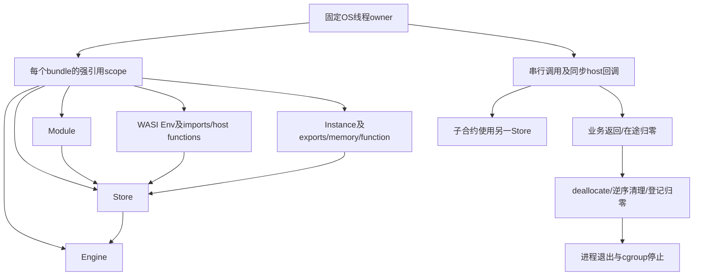

# Store所有权、释放和安全边界

本次以21B `620650d`、21D `87eb925`冻结源码为基础，再核对本次运行的绑定、链接库和所有者事件。不是根据“测试没崩溃”认证线程安全。核心证据：[21B并发契约](../step-21b-wasmer-store-lifecycle/CONCURRENCY_CONTRACT.md)、[21B原始源码](../step-21b-wasmer-store-lifecycle/evidence/current/)、[本次源码行号](SOURCE_INDEX.md)、[进程结果](processes.csv)。

## 实际版本

这是ChainMaker `vm-wasmer/v2@v2.4.0`目录内定制Go绑定，不能给它补一个未证明的上游wasmer-go SDK tag。E复制D的实验绑定，变化见[source.patch](source.patch)；生产绑定的Finalizer与实验scope接管必须区分。默认cgo的rpath指向E自己的packaged库，`audit/runtime-artifacts.json`记录ldd、ELF BuildID和hash。实际so SHA256 `dcdfa7164c58856f6e0c01597fd52c9a4c5f7da772751e3a874f7333612c3db9`，头文件/既有运行版本6.0.1，BuildID `69a11e39bb80e3024770895acf2b093aae04b04f`。精确构建commit、features和可重建来源仍未知。

本地native候选 `091074013fa056df0c6502262eae425927272e10`及上游固定v6.0.1用于结构证据，不把本机7.1.0 HEAD当作当前库来源。21B保存的实际二进制反汇编显示部分Store Rc增减为非原子指令。新版本Rust的Send/Sync声明不能替代C ABI及这个定制库的契约。

## 对象逐项核查

| 对象 | 原池所有权/访问 | E串行参考所有权与回收 |
|---|---|---|
| Engine / Store | `newVmPool`创建，`p.store`持有；同池全部Instance使用它。21B vm_pool.go:1028–1047 | 每bundle新Engine/Store；scope持有至所有调用结束；关闭后不再访问 |
| Module | Go `module.store`强引用原Store；池缓存一个Module；`NewInstance`传的是module.store，不是调用者另建的Store | `dCompile`在该bundle Store编译；没有把旧Module直接拿到新Store实例化 |
| Instance / Imports | wrappedInstance持有；instance.imports防止宿主函数过早回收；nativeInstance持StoreRef | bundle scope持有，使用次数受R1=0约束；业务返回后deallocate再清理 |
| Function | Exports/Extern借用wrapper维持owner；独立host函数有native handle及环境索引；Native()还有lazy缓存 | 同owner创建、调用、关闭；临时独立type登记清理，不将借用handle重复释放 |
| Memory | guest Store内对象；Go Data返回native backing slice，关闭/增长会影响生命周期 | 只在活动调用内读取/拷贝；Gas探针只读固定hash计数器，slice不逃逸到关闭后 |
| WASI | 原pool freelist持Env；Finalize用p.store；Initialize用Store/Instance；丢弃Env后原Finalizer可异步delete | Finalize/import/Initialize同Store；Env强引用scope；owner线程显式LIFO执行原清理函数 |
| Finalizer | 生产绑定runtime.SetFinalizer可在Go Finalizer线程触发C delete，不与在途调用自动join | `managedSetFinalizer`强引用登记替换所有绑定注册；GC没有本绑定native删除权；手动Close注销，scope逆序回收 |

绑定定位：store.go:18–53；module.go:58、76、255；instance.go:27–65、136；function.go:44、260–349；memory.go:22、95；wasi.go:268–305；exports.go:19、83。实验协议：step21d_runtime_test.go:85/154/181/213、wasmer-go/managed.go:25/51/73/130。全部为[source/vm](source/vm/)内行号；原始绑定见21B证据，不把实验改动倒写为生产机制。

## 并发组合的证据类别

| 组合 | 类别 | 判定 |
|---|---|---|
| 同Store无同步跨线程创建/执行/删除任意两个对象 | 源码证据；C API通用线程约束 | StoreRef为Rc<UnsafeCell<Store>>；创建和call都取得同一StoreMut；关闭还可能运行deallocate、WASI delete/Rc释放。原路径缺完整协议，不能放行。静态不安全路径已经成立，未声称本机观测到实际native race |
| 同Instance执行同时Close，或已释放handle继续访问 | 源码证据 | 没有借用计数保护；禁止 |
| 固定owner单Instance串行复用 | 源码证据＋实际功能验证 | E fact/ERC/normal R0及真实buyNow已执行；仅有界参考，非生产复用方案 |
| 固定owner不同Instance串行创建/执行/关闭 | 源码证据＋实际功能验证 | E R1已执行，同Module多Instance串行微型能力也通过；不外推长期资源或并发 |
| 独立Store并行 | 尚无工程端到端充分证据 | native隔离方向有价值，但Go全局配置、wrapper管理、WASI回调/回收仍需协议，本轮未执行 |
| 同Store同步callback内GetGas/SetGas | 固定版本源码用例＋有限实际验证 | 沿D有限重入协议、max2，单OS线程；不同于并发；不扩大到任意函数递归 |
| Module跨Store直接复用旧Go wrapper | 源码证据 | NewInstance仍选module.store，不能据“新建Store变量”宣称隔离 |

固定版本来源：[v6.0.1 Store](https://github.com/wasmerio/wasmer/blob/v6.0.1/lib/c-api/src/wasm_c_api/store.rs)、[Function](https://github.com/wasmerio/wasmer/blob/v6.0.1/lib/c-api/src/wasm_c_api/externals/function.rs)。官方C API通用规则/Issue边界与快照均在21B，不使用latest资料证明旧定制库安全。Go race或若干次无崩溃均不是native安全的充分证据。

## 21A报警与回收边界

[21B失败现场分析](../step-21b-wasmer-store-lifecycle/GUARD_ANALYSIS.md)已逐栈核对：create区间中worker停在无Store参数的wasi_config_new；另一Instance的Invoke在进入native业务前被CAS守卫拒绝。命中不同Instance生命周期区间交叠（A＋E）；没有证实同Instance冲突、close在途调用或已释放Store/WASI访问（B/C/D）。源码存在危险共享访问路径与该次日志抓到race是两件事。

E不存在grow/异步Close，排队0、根调用串行、真实子调用同步，native API均owner_tid相同。关闭要求inFlight=0、拒绝新请求、销毁缓存及预建剩余scope；注册表最终0。WASI内部线程的最终收束由独立进程/cgroup终止边界保证，scope计数不证明native内部全部内存已立即释放。

更正21D文字：其OWNERSHIP写结束“两次GC”，但最终提交dOwner实际默认一次，D_FORCE_GC=1才两次；E本次默认一次，没有调用间强制GC。依据源码与实际环境，不沿用不准确描述。没有扩大到连续100次或长期池运行许可。
