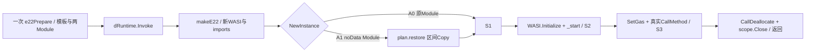

# Step-22 源码与计时审计

日期：2026-10-26，Asia/Shanghai。父提交 `87eb9256d5617b1ea07e7ea23e820f4720ff819b`，独立分支 `experiment/step22-serial-static-copy`。执行位置 `.worktrees/cvw-step22`；CVW主工作区仅接收本实验目录镜像。

## Copy 从哪里来

- Step16 `prototype/static_init_copy.go:112` 的 `prepareStaticMemory`，以及 `:262` 的 `staticMemoryPlan.restore`，复制到本目录 `source/vm/step22_static_test.go:85`、`:235`。`audit/step16_copy_identity.json` 实际核对了 gofmt 规范化后函数相等，未设计新算法。
- `prepareStaticMemory` 从原WASM解析active data，按原segment顺序覆盖到全零初始Image；合并重叠/相邻区间，丢弃最终全零区间；移除section 11生成noData。**不是先实例化原模块再追加Copy**。
- `restore` 检查Module指针/config/contract版本Key，`Exports.GetMemory` 后 `Memory.Data()` 取得native线性内存的Go slice视图；按Ranges执行Go `copy`。`wasmer-go/memory.go:95` 只有size/pointer查询及slice构造，没有额外Memory image副本。
- 这是既有 **Host区间Copy**；没有新增native Direct Copy、memcpy ABI、Arena、PB或S2快照。
- Step18 `prototype/step18_test.go:20` 的 `step18Pool` 继续用Step16 `newVmPool`/`CM_STATIC_MEMORY_COPY`/`CM_FRESH_INVOKE`。本轮复用其Copy机制和等价性检查思路，**不使用其A/P重编译变体或probe埋点WASM**。

## 原路径与本轮串行路径

Step16：`newVmPool` (`prototype/vm_pool.go:1063`) 一次准备plan与compileCode；`GetInstance:638 → NewInstance:709 → NewInstanceFromByteCode:1272 → wasmergo.NewInstance:1320 → plan.restore:1328 → WASI.Initialize:1342 → _start`。freshOnDemand让实例创建进入Invoke。原共享Store池的后台创建/异步关闭安全问题仍然存在。

本轮明确采用Step21D设计中**同所有者、每变体独占Store+Module、串行创建销毁Instance**的新参考模型，不运行原池，不把它称为原池TPS或真实节点路径：

本轮实际源码：`source/vm/step22_runtime_test.go:79` 准备；`:122` 创建；`:170` Copy；`:216` 每实例关闭；`:242` 最终缓存关闭；`source/vm/step21d_runtime_test.go:226` 完整Invoke；`:321` 真实 `SimContext.CallMethod`。`source/vm/wasmer-go/instance.go:27` 的 NewInstance 包含extern转换、`C.wasm_instance_new` 和导出包装；没有单独native-only timer。

## 缓存和所有权

- `e22State.cache` 每合约/变体一个 `e22Cache{scope,store,module,plan,key}`。prepare发生在调用前一次；Invoke缓存miss直接失败，绝不偷偷每次编译。
- plan.Key = SHA256(contract name + NUL + version + NUL + original WASM SHA + NUL + config SHA)；cache记录再附加 `/A0` 或 `/A1`。模板另保存ImageSHA/noDataSHA。
- 实际map查找用 `contractName+variant`，**只适用于本实验冻结的不可变registry/manifest**；不是通用升级失效缓存。restore不逐次重新hash整份WASM。构建配置SHA包含native、Gas编译源、Managed所有权源、max_pages、Go/GC等。代码/输入版本证据在environment、variants和audit中。
- Module从创建它的Store实例化，不跨Store借Module。A0/A1有各自Store，模型相同。`Module.Imports/Exports` 在持久scope提前物化，避免其懒缓存元数据随首个临时Instance scope被销毁。
- owner使用 `runtime.LockOSThread`；`managed.go` 保留Step21D实现，自动native finalizer改为强引用scope、同线程显式清理。一次调用全部完成并关闭scope后才开始下一次；真实跨合约调用使用另一个合约Store。原GetGas/SetGas有限同线程重入保持不变。
- 每次新WASI、新imports、新Instance；无业务Instance缓存、无后台grow、无channel取池。本实验没有可解释为池等待的数值。
- final cache.Close 和Store销毁只发生在实验进程尾部，另记 `cache_closed.close_ns`，不伪装成每次关闭均已收回全部native线程。managed登记回到基线/最终0只证明Go登记对象闭合，不证明长期native资源有界。

## 计时定义

所有同进程时长使用Go单调时钟 `time.Now()/Since/Sub`。以下是嵌套边界，**不能相加**：

| 字段 | 起止范围 |
|---|---|
| module_prepare | dCompile的config/engine/Store/ValidateModule/NewModule及Imports/Exports缓存；每模块一次 |
| template prepare | 解析、Image/noData生成及完整SHA审计；每逻辑WASM一次 |
| preparation_total | template+两变体module准备及记录；仅是实验双组准备总成本 |
| wasi_imports | 新WASI Finalize、GenerateImportObject、ChainMaker host GetImports；不是纯WASI单函数 |
| newinstance | 调用Go `w.NewInstance` 前后，**不含Copy**；含其native调用和wrapper开销 |
| copy | `plan.restore` 前后，含Key检查、memory lookup/view及区间copy；不等于纯memcpy |
| static_init（分析派生） | 同一条样本的newinstance+copy；没有混用两组中位数 |
| to_s1 | 本次dRuntime.Invoke开始至新Instance+必要Copy完成，含前面的WASI/import准备 |
| to_s2 | 同一次Invoke开始至WASI.Initialize和_start完成 |
| start | `_start.Call()`自身；仅接受已知成功的WASI proc_exit(0) trap |
| to_s3 | Invoke开始至业务CallMethod/Gas/result处理完成，关闭前 |
| callmethod | 真实sc.CallMethod自身；根buyNow包含全部子调用 |
| close | CallDeallocate+临时ManagedScope.Close；含Instance/WASI/import等注册对象的显式清理 |
| invoke | dRuntime.Invoke入口至其清理defer完成；**含创建、Copy、start、业务和上述close** |

模板与Module一次准备、初始化业务状态、配对初始账本clone、receipt序列化、根sample日志和最终缓存关闭不在Invoke内。嵌套子调用的诊断输出/VM工厂日志仍在父Invoke中，双方一致但有观测开销。因此本结果是**带相同诊断代码的串行实验VM路径**，不能当作生产RuntimeInstance.Invoke、客户端延迟或真实TPS。

预检在S1后做全Memory SHA，影响其后S2/S3/Invoke耗时；所有预检不进入性能表。正式调用不做此hash。

## 版本及适用边界

- Wasmer同一既有6.0.1 native二进制SHA `dcdfa7164c58856f6e0c01597fd52c9a4c5f7da772751e3a874f7333612c3db9`；没有编译/修改runtime。精确native构建源码映射仍未闭合。
- 同一Go1.25.0宿主test binary同时测A0/A1，固定GOMAXPROCS=2/GOGC=100，原opcode/fn Gas映射和max_pages512与Step16相同，`audit/step16_gas_config_identity.json`提供函数片段校验。runtimeGasLimit仍为2^31−1，未改Gas规则。
- compute/fact/exchange/identity原WASM与Step16现存原产物SHA相同；**ERC721为Step21D候选9b6eb47d…，不同于Step16的4fbad3f2…**。本轮A0/A1始终是同一逻辑WASM，无跨版本Gas默认相等假设。
- 附近合约源go.mod写SDK v0.1.3，但没有本轮重编译合约，不能单凭附近源码证明历史二进制的精确SDK/compiler构建来源。
- noData保留全部非Data section原字节，实际逐section核对见variants。自动start、导入Memory/global/table、复杂offset、passive data、DataCount、复杂/passive element等被原parser拒绝。本实验遇不支持就停止，不隐藏fallback/失败组。
- 原始/final WASM编译验证成功，不等于所有异常路径/Table函数身份已验证。详见CORRECTNESS.md。
