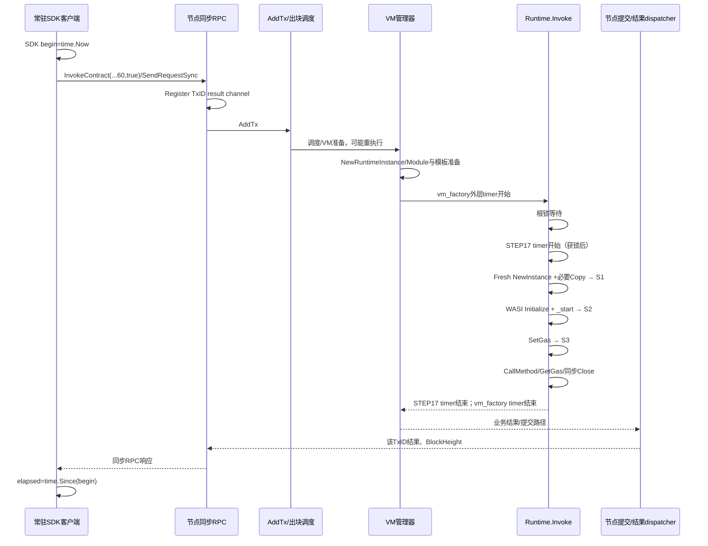

# Step-30测量边界冻结（新运行尚未准入）

## 已恢复的客户端→节点链

图中VM/提交之间是调用关系概览，不是每笔独立持久化时刻的实测；节点可在块执行/验证流程重执行同一TxID，不能假定只有一次VM调用。Step17并发组原始5248热响应对应6008根调用，382个TxID多次执行；本轮已重新读原stdout验证。

## 原窗口的包含关系

| 窗口 | 包含 | 不具备的细分 |
|---|---|---|
| SDK elapsed | 组包/签名、RPC、调度、执行、节点同步提交结果等待 | 原客户端未存SDK begin/end绝对mono，不能补造 |
| driver send→receive | 管道、SDK调用、stdout传回及driver轮询 | 不是SDK窗口，不可代替client elapsed |
| vm_factory Invoke timer | Runtime.Invoke整个调用，含旧根锁等待 | 旧20 low stdout未保存该外层逐笔timer |
| STEP17 invoke_ns | 获锁后Fresh创建、Copy、WASI/start、业务及同步Close | 不含根锁/模块准备，不能冒名历史factory口径 |
| S1 | Fresh准备入口至NewInstance+Copy完成 | 独立NewInstance缺失 |
| S2−S1 | WASI初始化、取start、_start等 | 不能写成纯_start |
| S3 | 创建入口到SetGas后 | 旧节点S3与Step28/29的“业务后S3”定义不同，不能混用 |
| child Invoke | 完整root调用内的嵌套部分 | 不与root重复相加 |
| client−全部root Invoke时长 | 逐Tx可定义未细分残差 | 不是单独的AddTx→VM，也含锁/准备/提交/RPC等 |

同一进程duration只用单调time.Time/time.Since，跨进程不直接减timestamp。两个嵌套duration相减只能叫残差；不定位单向网络时间。旧Detailed trace可用节点自身mono事件计算AddTx返回→VM入口，但本轮low与新Step30无该事件，不能移植数值。

## 四种速率必须分列

1. **客户端成功响应速率**：唯一成功响应数/driver观察窗口墙钟。历史重算从本endpoint第一条warm job发送到最后warm响应收到；窗口包含交替另endpoint请求时间，不是节点饱和吞吐。
2. **独立确认的提交TPS**：确认提交的唯一TxID数/明确提交测量窗；当前缺该窗，NA。同步响应块高说明节点报告提交结果，不提供独立PutBlock时间序列。
3. **VM日志等效速率**：若factory原日志齐全，可按筛选后成功N/Σ同一集合Invoke秒数定义；旧历史脚本有过滤前分母累加等差异，不能默认等价。Step20只有STEP17锁内时长，另列inner-root equivalent，不能当王浅秋原factory指标。
4. **历史并发日志窗口速率**：N/(maxEnd−minStart)，依赖历史入口/跨节点时钟等条件；不是客户端成功请求速率，也未证明是历史PPT所用入口。

绝不把1/平均VM时间当成功提交TPS。本轮新运行被安全门槛阻断，新G0/G1/G2速率全部missing，不填0。

## 未来新E2E的最小协议（未执行）

先满足Store owner/finalizer及有界回收门槛，验证实际节点集成版本；保持客户端SDK begin→同步响应返回，唯一TxID，同一原件家族G0/G1与等价初始账本。G2同源A缺失时blocked；若切换全套Step18则登记为受控新E2E、全部重新部署/生成匹配artifact，不能混家族。

单客户端连续闭环、无100ms Sleep，保持同一并发数；每批20完整对、3批为目标，不是凑数要求。先少量功能预检，cold/模板准备单列且保留首笔；正式组顺序平衡、端点角色跨批交换；只复用低开销VM日志。每批检查RSS走势/在途/未知提交/退出，资源软限仍2560MiB/220线程，MemoryMax3GiB；不靠轮换进程或抬限掩盖未解决增长。

保留每请求SDK begin/end及elapsed、driver边界、requestID、TxID、root attempts、业务状态/写集/事件、提交证据；可靠提交事件或独立账本窗口建立前不报告提交TPS。旧17/20客户端不满足这些新增字段时标“受控新E2E”，不称精确重放。当前没有实现/运行此协议。

本地提交语义进一步追踪：CommitBlock的store.PutBlock返回→AddBlock发布msgbus.BlockInfo→EventSubscriber.NewBlockEvent→TxResultDispatcher按TxID送result→同步RPC返回。当前成功响应覆盖这一节点本地提交链；未记录PutBlock精确时刻，因此不能输出独立commit-event时间窗的吞吐或端到端分段。详见AUDIT补充源码行号。
