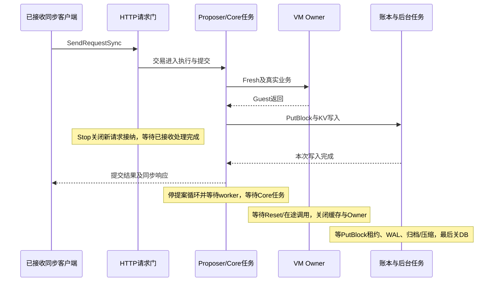

# 最小关闭协议

请求门只保护接纳计数，不串行化业务，不是围绕native对象新增全局锁。Core门在go之前登记，防止goroutine尚未开始就被漏掉；提案循环先退出再等worker，避免Wait与后续Add的空组竞态。Store租约覆盖整个PutBlock，后台WAL在父任务归零前已登记。

| 等待 | 上限/失败处理 |
|---|---|
| HTTP完整响应请求门 | 20秒；超时fail-fast，不继续DB Close |
| Proposer loop/worker | 15秒context；错误在Core触发失败退出 |
| Core任务门 | 15秒；无错误返回接口，实验fail-fast |
| VM Owner Stop | 10秒；模块错误传播并中止后续Close |
| PutBlock与WAL | 共用15秒context；超时不关闭DB |
| 归档循环/压缩 | 15秒；错误不再被忽略 |
| 诊断HTTP server | 2秒Shutdown与完成等待 |
| 诊断rendezvous | 12秒，仅测试有意暂停，不是正常业务调度 |
| 外部进程 | 既有RuntimeMax180s、TimeoutStop10s与资源保护 |

底层LevelDB/native API本身不支持逐调用context取消，不能声称所有磁盘/底层调用都可在Go内安全打断；最终进程监督仍是兜底。未发生超时路径不代表验证了磁盘故障恢复。超时失败不会伪装成已完成交易。

Store Close缓存实际关闭错误，重复调用不会将失败变成nil；nil Close保留旧语义。归档原Sleep改为timer/select可及时响应stop，不改变归档规则，不添加睡眠。
