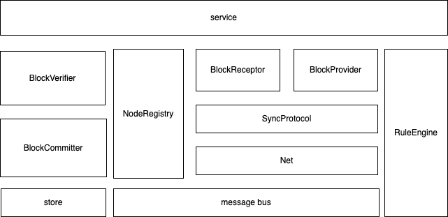
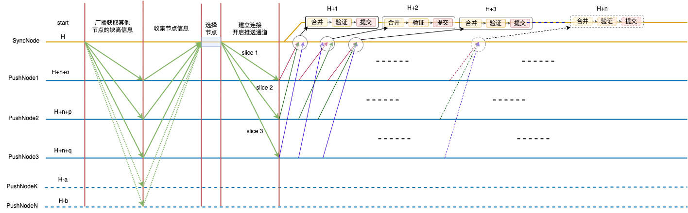
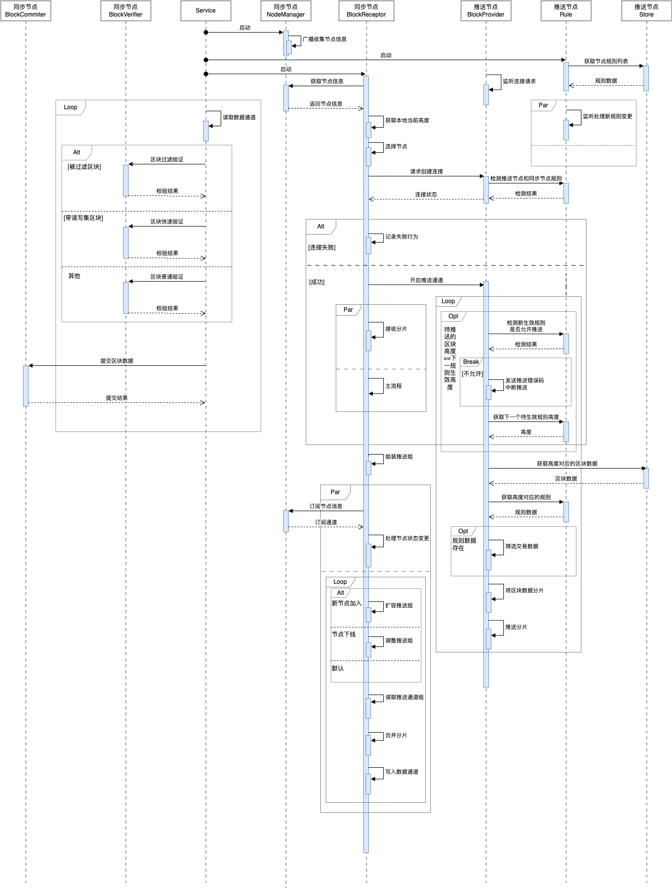

# 						同步模块

​		在区块链中，每个完全节点都拥有完整的区块链数据，而对于新加入的节点抑或现存节点由于网络等原因导致区块数据落后于链上数据时，需要有一种机制能够保证落后节点能够追赶到链上的最新数据，这个机制就是同步。

长安链的同步模块实现了区块同步功能，其具有以下特性

- 以事件驱动为模型，架构稳定
- 对区块数据进行分片推送，性能良好
- 可配置的数据筛选规则，支持数据的选择性同步

## 设计原理

### 	整体架构





长安链同步服务模块包含主要功能：

1. Service: 主逻辑入口，负责对外提供接口，管理各子模块，监听和接收BlockReceptor发送的区块数据，对区块进行验证和提交。

2. NodeManager: 节点管理模块，负责收集和维护可连接的链上其他节点的区块高度信息，并将节点信息的变动通知到订阅模块。

3. BlockProvider: 数据提供模块，负责监听和维护同步连接，根据同步节点的同步请求，为同步节点推送区块数据分片，如果同步节点配置有筛选规则，数据提供节点需要先根据规则对数据进行筛选后再分片推送。

4. BlockReceptor: 数据接收模块，根据节点管理模块中节点的区块信息，筛选出比自己区块高度高的节点，然后根据择优规则从中挑选出可提供数据的n个节点，发送同步请求，而后将收到的数据分片合并成完整的区块数据，推送出去。

5. SyncProtocol: 同步协议模块，定义了同步各交互流程的协议及数据结构，实现了协议包的收发封解及处理逻辑。

6. Net: 网络模块，抽象监听、拨号、连接接口，并基于message bus实现了网络各接口。

7. Rule: 规则模块，实现了基于go语法的规则引擎，定义了规则语义，实现了规则的解析及对规则的管理。

8. BlockVerifier: 区块验证，根据区块携带的额外数据执行不同的验证流程。

9. BlockCommitter: 区块提交，将区块数据提交到本地账本。

   

### 工作流程

​	同步节点流程：

1. 节点启动后，会定时广播获取链上其他节点的区块高度信息，并在同步的整个生命周期内探测节点的活跃性。
2. 获取本地当前块高H，并根据收集的节点块高信息、同步模块的配置信息以及各节点的行为状态(网络状况、作恶情况、数据提供状况等)择优选择可同步的节点
3. 同选择的节点建立连接，并开辟数据分片推送通道，如选择的3个节点PushNode1、PushNode2、PushNode3，则请求将每个区块切分为3部分，PushNode1推送区块的第1/3片，PushNode2第2/3片，PushNode3第3/3片。
4. 如果建立连接或推送通道失败，则对推送节点进行失败的行为记录，将其作为为节点的打分凭据。
5. 推送节点从块高H+1按照分片规则依次推送各个块高的分片。
6. 同步节点依次从各通道内获取一个分片，如果从某个节点的通道中连续多次未获取分片，则判定此节点为失效节点，并将其踢出，然后对其进行失效行为记录，对于未取得的分片，则利用补偿机制，从其他有效节点获取。
7. 将分片进行合并，然后进行验证和提交。如果验证失败，则会对节点进行验证失败的行为记录。
8. 如果节点的区块高度，达到了推送节点的最高区块高度，则进行轮训等待，直到发现推送节点的最高区块高于自身高度。

在整个同步流程中，同步节点会根据推送节点的状态(如网络状况较差推送分片迟缓，如数据已经不满足同步节点需求等)动态地从推送组中删除不可用的推送节点，亦会将新增的良好的节点或现存状况改善的节点添加到推送组中。总之推送组会根据运行状况进行动态伸缩。

​	推送节点流程：

1. 节点启动后开启连接监听，等待同步节点连接请求。
2. 收到同步节点的连接请求后，推送节点校验自身账本的数据是否满足同步节点要同步的区块对应的规则，如果不满足则拒绝连接。
3. 建立连接并开启推送通道后，推送节点从同步节点请求的起始高度开始，对数据进行推送。
4. 获取下一个待生效的同步规则的生效高度(推送节点和同步节点待生效规则最小值)
5. 如果当前高度等于下个待生效的高度，校验推送节点自身的区块数据是否满足待生效的规则需要
6. 如果不满足，则中断推送流程，并发送错误码
7. 满足，变更当前生效的规则，然后按照规则对区块数据进行筛选。
8. 将筛选后数据，按照分片规则拆分，推送需要的分片。
9. 如果推送节点将数据推送到最新高度，则等待新区块到来，然后继续推送。
10. 如果推送通道被同步节点关闭，则退出推送流程。





### 模块交互图




### 规则设计

​		同步模块实现了基于go语法的规则引擎，支持对区块交易进行过滤和筛选，可以通过为节点指定同步规则来限制节点可同步的区块交易数据权限，以达到对数据的保护抑或对节点资源的节省。

1. 标识符(lable)定义： 

   - O: 交易发起组织

   - I:  交易发起身份

   - TT: 交易类型

   - TD: 交易ID

   - C: 合约

​		注：使用标识C(合约)时，可指定{合约名}或者{合约名}.{合约方法}，不可单独指定合约方法

2. 支持的语法

   - 算术运算符:  ==、!=
   - 逻辑运算符:  &&、||
   - 数据类型: 数字、字符串
   - 函数: contain_of
   - 优先级符号：()

   说明：

   字符串数据类型要遵从go语法，如：O=="org1" 而不是 O==org1

   contain_of:  contian_of(lable, var) 指定标识是否包含var指定的数据，如contain_of(O, "org1")表示交易发起组织的字符串中含有org1组织

3. 示例

   ```
   (O == "org1" || O == "org2") && I == "admin" && TT == 0 && (contain_of(C, "save") || C == "transfer" || C == "cross.commit")
   ```

   解释：筛选由组织org1或组织org2中的admin使用合约名包含save的合约或者使用transfer合约或者使用合约名为cross合约方法commit发起的普通交易(TT==0)

4. 同步规则系统合约介绍

   合约名：SYNC_RULE

   合约方法：

   - ADD: 添加规则

     参数

     - node_id: string, required 添加规则的目的节点
     - rule: string,required 添加的规则内容，空字符串表示无规则。
     - begin_height: uint64, option 规则生效的起始高度，除为节点首次配置规则，begin_height必须大于打包此交易的区块高度，如果未指定(begin_height==0)，则默认为此交易所在区块的下一个区块高度为生效起始高度
     - end_height: uint64, option 规则失效高度，规则失效高度必须大于生效高度，未指定，则一直生效直到被下一个生效高度>自己生效高度的规则出现

     说明：如果新配置的规则的起始高度比现存的规则的起始高度小，那么现存的所有的起始高度比其大的规则均会被擦除。

   - CLEAR: 清除所有规则

     参数

     - node_id: string, required 清除规则的目的节点

     说明：将会清除为节点已配置的所有规则，之前配置的规则也会失效，如果只是希望从未来的某个高度不再配置规则，使用ADD添加一个空规则即可；清除规则后的首次添加规则，将不作为首次配置

   - GET: 获取已配置的规则列表

     参数

     - node_id: string, required 获取规则的目的节点

   - COMPARE: 比对规则是否有包含关系

     参数

     - rule_contain: string, required 比对包含的规则
     - rule_contained:  string, required 比对被包含的规则

     说明：比对rule_contain指定的规则是否包含rule_contained指定的规则

注：

- 共识节点不可被添加规则。
- 非共识节点被添加规则后，如若被升级为共识节点，系统会将节点的同步规则清空，为保证节点能够正常作业，需删除账本数据(如已经同步到被规则筛选过的非完整区块数据)，以保证节点能够拥有完整的区块数据。
- 规则只会对普通交易有效，配置交易和管理类交易等不会执行规则过滤。


## 使用方式

### 配置参数

同步模块支持可配置的参数如下：

```
node:
    fast_sync:
        enabled: bool  //是否开启快速同步，默认开启

sync:
	block_pool_size: uint32  //块缓存池大小，表示可最大缓存同步过来待验证的区块个数，默认为16
	prefer_nodes: []string  //优选节点，指定想从哪些节点同步数据
	ideal_height_distance: uint64 //理想高度距离，表示同步到距离链上最高高度到达此差值时触发同步完成信号， 默认为1
	highest_block_wait_period_seconds: uint32 //同步到最新高度后检测需要同步的时间周期，默认300s
```

### 规则使用

1. go-sdk

   规则相关接口：

   - AddSyncRule(nodeId, rule **string**, beginHeight, endHeight **int**) (*common.Payload, **error**)

     说明：生成为节点添加规则的交易*payload*

   - ClearNodeRule(nodeId **string**) (*common.Payload, **error**)

     说明：生成清除节点的规则交易*payload*

   - GetNodeRule(nodeId **string**) (*sync.NodeRule, **error**)

     说明： 获取节点的规则列表

   - RuleCompareContain(rule_contain, rule_contained **string**) (**bool**, **error**)

     说明：比对rule_contain规则的是否包含rule_contained规则

2. cmc

   - 添加规则
   
     ```
     ./cmc client contract system add-rule \
     --sdk-conf-path=./testdata/sdk_config.yml \
     --chain-id={chain_id} \   					//链ID
     --node-id={node_id} \  							//节点ID
     --begin-height=[begin_height] \ 		//规则生效起始区块，选填
     --end-height=[end_height] \     		//规则失效高度，选填
     --rule={rule_content} \   					//规则内容
     --sync-result=[true]
     ```
   
     
   
   - 清除规则
   
     ```
     ./cmc client contract system clear-rule \
     --sdk-conf-path=./testdata/sdk_config1.yml \
     --chain-id={chain_id} \		//链ID
     --node-id={node_id} \			//节点ID
     --sync-result=true
     ```
   
     
   
   - 获取规则
   
     ```
     ./cmc client contract system get-rule \
     --sdk-conf-path=./testdata/sdk_config1.yml \
     --chain-id={chain_id} \    //链ID
     --node-id={node_id} \			//节点ID
     --sync-result=true
     ```
   
     
   
   - 比对规则包含关系
   
     ```
     ./cmc client contract system compare-rule \
     --sdk-conf-path=./testdata/sdk_config.yml \
     --wide_rule={contain_rule} \    //宽范围规则，即：对比包含其他规则的规则
     --narrow_rule={contained_rule} \		//窄范围规则，即：比对被包含的规则
     --sync-result=[true]
     ```
   


## 使用示例

背景：现在链chain1上共有四个共识节点，节点1分属组织1(wx-org1.chainmaker.org)、节点2分属组织2(wx-org2.chainmaker.org)、节点3分属组织3(wx-org3.chainmaker.org)、节点4分属组织4(wx-org4.chainmaker.org)，现欲加入一个分属组织1的新普通节点(非共识节点)节点5，节点id: QmYwM9t65bCP6ACCDrh9FbRF3xMdzCTGW5DL4D9j5Z8MqQ。

1. ##### 为了限制节点5只能同步其所属组织1的数据，需要在节点加入链之前对其进行同步规则配置。

```
./cmc client contract system add-rule \
--sdk-conf-path=./testdata/sdk_config.yml \
--chain-id="chain1" \
--node-id="QmYwM9t65bCP6ACCDrh9FbRF3xMdzCTGW5DL4D9j5Z8MqQ" \
--begin-height=1 \
--rule='O=="wx-org1.chainmaker.org"' \
--sync-result=true

resp: contract_result:<message:"OK" > tx_id:"1773345fd724a896ca18b89a707b7463e702ec7a80bb4dad89e86ca78d06f3d6" tx_timestamp:1689751871 tx_block_height:151 
```

Q&A

- Q: 为什么在节点加入前配置？

​		A: 因为如果节点加入链之后再配置规则，将会导致规则交易上链前节点已经开始同步数据，无法对这些数据起到过滤作用。

- Q: --begin-height为什么是1而不是0？

​		A: 首先区块高度为0的区块为配置块不需要同步，从高度1开始同步；其次高度0会被认为没有指定生效高度，系统将会以规则交易被打包的下一个区块高度作为生效高度。

2. ##### 如果节点5由于网络隔离问题，不能直接访问(不能直连)到除节点1以外的其他节点，此时最好对同步进行节点优选配置

   chainmaker.yml

   ```
   sync:
   	prefer_nodes: 
   	  - "QmRbRxyeWTwEr6exMEK9sEzfQfo7Ak7tyDehtCmN6bF8sF" //节点1的节点ID
   ```

   Q&A

   Q:  为什么做这个配置？不配置可否？

   A:  做这个配置可以避免同步节点可能在同步过程中会多次尝试那些不能直连的节点导致不必要的操作，如果不配置并不会影响正常工作流程。

3. ##### 查看节点的区块数据

   比如想查看一下块高20的区块数据

   ```
   ./cmc query block-by-height 20 \
   --chain-id=chain1 \
   --sdk-conf-path=./testdata/sdk_config.yml
   ```

​		这个区块中包含了组织1、组织2、组织3的交易，由于对节点5配置了同步规则，所以我们看到的区块数据中的交易数据分别如下：

组织1(wx-org1.chainmaker.org)的交易(正常交易)：

```
{
        "payload": {
          "chain_id": "chain1",
          "contract_name": "save",
          "method": "save",
          "parameters": [
            {
              "key": "key",
              "value": "c2F2ZV8xOF8yXzE2ODk2Njc4MTUyOTg4MDI1MjI="
            },
            {
              "key": "data",
              "value": "MTIzXzE4XzJfMTY4OTY2NzgxNTI5ODgwNTA1Nw=="
            }
          ],
          "timestamp": 1689667815,
          "tx_id": "1772e7ecff4bb24eca00448614459a2e6ce94101f4964a59b94f24b549772288"
        },
        "result": {
          "contract_result": {
            "contract_event": [
              {
                "contract_name": "save",
                "event_data": [
                  "save_18_2_1689667815298802522",
                  "123_18_2_1689667815298805057",
                  ""
                ],
                "topic": "topic_save",
                "tx_id": "1772e7ecff4bb24eca00448614459a2e6ce94101f4964a59b94f24b549772288"
              }
            ],
            "message": "Success",
            "result": "c2F2ZV8xOF8yXzE2ODk2Njc4MTUyOTg4MDI1MjI="
          },
          "rw_set_hash": "WFgnWHv+kxdIcuvu9M0rY08A8Z1mCv06LGwWcwQ2xgc="
        },
        "sender": {
          "signature": "MEYCIQCo19XlXq47hUFNoK57KgZ6jEAPeI6Hrm8wgwAZrpZfOQIhAN70QtC4IO61c4TGUkAJT1OXUXISZ65JhCmIm5d3UkFd",
          "signer": {
            "member_info": "LS0tLS1CRUdJTiBDRVJUSUZJQ0FURS0tLS0tCk1JSUNlRENDQWg2Z0F3SUJBZ0lEQ1VDdU1Bb0dDQ3FHU000OUJBTUNNSUdLTVFzd0NRWURWUVFHRXdKRFRqRVEKTUE0R0ExVUVDQk1IUW1WcGFtbHVaekVRTUE0R0ExVUVCeE1IUW1WcGFtbHVaekVmTUIwR0ExVUVDaE1XZDNndApiM0puTVM1amFHRnBibTFoYTJWeUxtOXlaekVTTUJBR0ExVUVDeE1KY205dmRDMWpaWEowTVNJd0lBWURWUVFECkV4bGpZUzUzZUMxdmNtY3hMbU5vWVdsdWJXRnJaWEl1YjNKbk1CNFhEVEl6TURVeE1EQXpNVEF5TmxvWERUSTQKTURVd09EQXpNVEF5Tmxvd2daRXhDekFKQmdOVkJBWVRBa05PTVJBd0RnWURWUVFJRXdkQ1pXbHFhVzVuTVJBdwpEZ1lEVlFRSEV3ZENaV2xxYVc1bk1SOHdIUVlEVlFRS0V4WjNlQzF2Y21jeExtTm9ZV2x1YldGclpYSXViM0puCk1ROHdEUVlEVlFRTEV3WmpiR2xsYm5ReExEQXFCZ05WQkFNVEkyTnNhV1Z1ZERFdWMybG5iaTUzZUMxdmNtY3gKTG1Ob1lXbHViV0ZyWlhJdWIzSm5NRmt3RXdZSEtvWkl6ajBDQVFZSUtvWkl6ajBEQVFjRFFnQUVpUUowS2o2UQowS3ZJWFA2OTBCS3huNk8rcFhnSmcxMEhBSVp2dWg4blRsQnFTZEgvSnQ4RkxDay82Yko2bHpRRHJkSndwam5TCnNBMW9vMG9zNFh6Q1ZhTnFNR2d3RGdZRFZSMFBBUUgvQkFRREFnYkFNQ2tHQTFVZERnUWlCQ0RrcUZzclNDMXAKZ0pKbGROQUVGSFpiYkFIQjRxNkVHMkdzb2pITTRzd0V1ekFyQmdOVkhTTUVKREFpZ0NDTGMyR2JrWnkzNWdYUApZTCtNSFF4K3BONi84Ym1zM1o2UGN6VU9lUE1DcVRBS0JnZ3Foa2pPUFFRREFnTklBREJGQWlFQTQ1V1FGTnV6CmU2VkhWMTc2Sy9OSnkzdTVlZHNuTENFTlJ6c2ZISC9wN3g0Q0lBalA0bGNjYU80YTR3c0hacFR3SFRiNmgyVWoKMzdZWTd6UnNSd2J1TlZTTQotLS0tLUVORCBDRVJUSUZJQ0FURS0tLS0tCg==",
            "org_id": "wx-org1.chainmaker.org"
          }
        }
      },
```

组织2(wx-org2.chainmaker.org)、组织3的交易(被过滤交易)：

```
{
        "payload": {
          "tx_id": "1772e7ecc8b553c1ca852d0a4c661ab07228c754c9d34024b42eee3dd56b4351"
        },
        "result": {
          "rw_set_hash": "0EOD0hn1pLWrZrXQdtdc0pRYu6g0glTbACNdrBRk1T8="
        },
        "sender": {
          "signature": "MEUCIAF5UqK5kAigD35oRVSPMNmWKchspeG09QuTC9GFBBf3AiEAkeIYy0eOdFDQflK4j5Jqz8rVDnubklCeu+wLNSus504=",
          "signer": {
            "member_info": "LS0tLS1CRUdJTiBDRVJUSUZJQ0FURS0tLS0tCk1JSUNlRENDQWg2Z0F3SUJBZ0lEQ3c4cU1Bb0dDQ3FHU000OUJBTUNNSUdLTVFzd0NRWURWUVFHRXdKRFRqRVEKTUE0R0ExVUVDQk1IUW1WcGFtbHVaekVRTUE0R0ExVUVCeE1IUW1WcGFtbHVaekVmTUIwR0ExVUVDaE1XZDNndApiM0puTWk1amFHRnBibTFoYTJWeUxtOXlaekVTTUJBR0ExVUVDeE1KY205dmRDMWpaWEowTVNJd0lBWURWUVFECkV4bGpZUzUzZUMxdmNtY3lMbU5vWVdsdWJXRnJaWEl1YjNKbk1CNFhEVEl6TURVeE1EQXpNVEF5TmxvWERUSTQKTURVd09EQXpNVEF5Tmxvd2daRXhDekFKQmdOVkJBWVRBa05PTVJBd0RnWURWUVFJRXdkQ1pXbHFhVzVuTVJBdwpEZ1lEVlFRSEV3ZENaV2xxYVc1bk1SOHdIUVlEVlFRS0V4WjNlQzF2Y21jeUxtTm9ZV2x1YldGclpYSXViM0puCk1ROHdEUVlEVlFRTEV3WmpiR2xsYm5ReExEQXFCZ05WQkFNVEkyTnNhV1Z1ZERFdWMybG5iaTUzZUMxdmNtY3kKTG1Ob1lXbHViV0ZyWlhJdWIzSm5NRmt3RXdZSEtvWkl6ajBDQVFZSUtvWkl6ajBEQVFjRFFnQUVBSHpFNzNvTgpObDNVRGY5K1dUQjAwWmRySTRMVGJuNHJsWHFONUhJZFA5UmxtcS83bVR3aFl4dlRzNzZ6RkZLOGtpQ2dqZnZQCkN4L3FIZitzL3dtZWJhTnFNR2d3RGdZRFZSMFBBUUgvQkFRREFnYkFNQ2tHQTFVZERnUWlCQ0FQRCtucWJkdlMKajg0MHhkWUhiczBJS3RvUjFNTTRuTU1sbGxVcXQxZnRsakFyQmdOVkhTTUVKREFpZ0NERUdBQkZvQ1dnN2lNYworM203S1l1QmVRQ2dRc1paTlkyRm1uVlNIUzhrYVRBS0JnZ3Foa2pPUFFRREFnTklBREJGQWlFQTB0cmF6QW10Cm0wZFlsSjRqeGhPcDhtcjd4YmtIWnpvVDQ3d2xyY1pUekhrQ0lIZ2FLdnNTUllaOFJFQVNueGtUSFlGRzEwZGoKQ1ZkT1NVdU1mZjRXWjNIRgotLS0tLUVORCBDRVJUSUZJQ0FURS0tLS0tCg==",
            "org_id": "wx-org2.chainmaker.org"
          }
        }
      },
```

组织2的交易将不会像组织1的交易一样拥有完整数据，目前只保留了交易id、读写集hash、以及组织和签名用户

而对于查询的读写集信息如下：

```
"rwset_list": [
	 {
      "tx_id": "1772e7ecff4bb24eca00448614459a2e6ce94101f4964a59b94f24b549772288",
      "tx_writes": [
        {
          "contract_name": "save",
          "key": "c2F2ZSNzYXZlXzE4XzJfMTY4OTY2NzgxNTI5ODgwMjUyMg==",
          "value": "eyJrZXkiOiJzYXZlXzE4XzJfMTY4OTY2NzgxNTI5ODgwMjUyMiIsImRhdGEiOiIxMjNfMThfMl8xNjg5NjY3ODE1Mjk4ODA1MDU3IiwiZGVzYyI6IiJ9"
        }
      ]
    },
    {},
 ]
```

读写集信息中只有组织1交易(tx_id:1772e7ecff4bb24eca00448614459a2e6ce94101f4964a59b94f24b549772288)的读写集，而组织2/组织3交易的读写集将会为空。

4. ##### 查看节点5的规则

   ```
   ./cmc client contract system get-rule \
   --sdk-conf-path=./testdata/sdk_config.yml \
   --chain-id="chain1" \
   --node-id="QmYwM9t65bCP6ACCDrh9FbRF3xMdzCTGW5DL4D9j5Z8MqQ" \
   --sync-result=true
   
   resp: latest_rule_id:1 rules:<id:1 begin_height:1 content:"O==\"wx-org1.chainmaker.org\"" >
   ```

5. ##### 清空节点5的规则

   ```
   ./cmc client contract system clear-rule \
   --sdk-conf-path=./testdata/sdk_config.yml \
   --chain-id="chain1" \
   --node-id="QmYwM9t65bCP6ACCDrh9FbRF3xMdzCTGW5DL4D9j5Z8MqQ" \
   --sync-result=true
   
   resp: contract_result:<message:"OK" > tx_id:"177334f9553b1de7ca4d8509489bc3e5b6d84cd686004bdebf158eb320b168f8" tx_timestamp:1689752530 tx_block_height:143  
   
   resp: latest_rule_id:2 rules:<id:2 > 
   ```

   已清空节点的所有规则

6. ##### 查看新的区块数据

```
./cmc query block-by-height 150 \
--chain-id=chain1 \
--sdk-conf-path=./testdata/sdk_config.yml
```

```
 {
        "payload": {
          "chain_id": "chain1",
          "contract_name": "save",
          "method": "save",
          "parameters": [
            {
              "key": "key",
              "value": "c2F2ZV8zOV8yXzE2ODk3MzU0ODY5MDk2NzE2NDA="
            },
            {
              "key": "data",
              "value": "MTIzXzM5XzJfMTY4OTczNTQ4NjkwOTY3NDE2NQ=="
            }
          ],
          "timestamp": 1689735486,
          "tx_id": "17732579059f7948ca4b7d4ae270e8f4dfa946c553af4843a7ab4ad64e610fbf"
        },
        "result": {
          "contract_result": {
            "contract_event": [
              {
                "contract_name": "save",
                "event_data": [
                  "save_39_2_1689735486909671640",
                  "123_39_2_1689735486909674165",
                  ""
                ],
                "topic": "topic_save",
                "tx_id": "17732579059f7948ca4b7d4ae270e8f4dfa946c553af4843a7ab4ad64e610fbf"
              }
            ],
            "message": "Success",
            "result": "c2F2ZV8zOV8yXzE2ODk3MzU0ODY5MDk2NzE2NDA="
          },
          "rw_set_hash": "SKts9QUhs9f+9HYUdgAXcjOQaM14rtcswDsXZSywl4Y="
        },
        "sender": {
          "signature": "MEYCIQDTuhdtsFjoPtTr6fC3OwYqkzy3TbD+vWQLHQhZ12m12QIhAO+qhiB7HThkMWMJqshrN/NSdv3kV5pKwQxXO+4Bb4IS",
          "signer": {
            "member_info": "LS0tLS1CRUdJTiBDRVJUSUZJQ0FURS0tLS0tCk1JSUNlRENDQWg2Z0F3SUJBZ0lEQ3c4cU1Bb0dDQ3FHU000OUJBTUNNSUdLTVFzd0NRWURWUVFHRXdKRFRqRVEKTUE0R0ExVUVDQk1IUW1WcGFtbHVaekVRTUE0R0ExVUVCeE1IUW1WcGFtbHVaekVmTUIwR0ExVUVDaE1XZDNndApiM0puTWk1amFHRnBibTFoYTJWeUxtOXlaekVTTUJBR0ExVUVDeE1KY205dmRDMWpaWEowTVNJd0lBWURWUVFECkV4bGpZUzUzZUMxdmNtY3lMbU5vWVdsdWJXRnJaWEl1YjNKbk1CNFhEVEl6TURVeE1EQXpNVEF5TmxvWERUSTQKTURVd09EQXpNVEF5Tmxvd2daRXhDekFKQmdOVkJBWVRBa05PTVJBd0RnWURWUVFJRXdkQ1pXbHFhVzVuTVJBdwpEZ1lEVlFRSEV3ZENaV2xxYVc1bk1SOHdIUVlEVlFRS0V4WjNlQzF2Y21jeUxtTm9ZV2x1YldGclpYSXViM0puCk1ROHdEUVlEVlFRTEV3WmpiR2xsYm5ReExEQXFCZ05WQkFNVEkyTnNhV1Z1ZERFdWMybG5iaTUzZUMxdmNtY3kKTG1Ob1lXbHViV0ZyWlhJdWIzSm5NRmt3RXdZSEtvWkl6ajBDQVFZSUtvWkl6ajBEQVFjRFFnQUVBSHpFNzNvTgpObDNVRGY5K1dUQjAwWmRySTRMVGJuNHJsWHFONUhJZFA5UmxtcS83bVR3aFl4dlRzNzZ6RkZLOGtpQ2dqZnZQCkN4L3FIZitzL3dtZWJhTnFNR2d3RGdZRFZSMFBBUUgvQkFRREFnYkFNQ2tHQTFVZERnUWlCQ0FQRCtucWJkdlMKajg0MHhkWUhiczBJS3RvUjFNTTRuTU1sbGxVcXQxZnRsakFyQmdOVkhTTUVKREFpZ0NERUdBQkZvQ1dnN2lNYworM203S1l1QmVRQ2dRc1paTlkyRm1uVlNIUzhrYVRBS0JnZ3Foa2pPUFFRREFnTklBREJGQWlFQTB0cmF6QW10Cm0wZFlsSjRqeGhPcDhtcjd4YmtIWnpvVDQ3d2xyY1pUekhrQ0lIZ2FLdnNTUllaOFJFQVNueGtUSFlGRzEwZGoKQ1ZkT1NVdU1mZjRXWjNIRgotLS0tLUVORCBDRVJUSUZJQ0FURS0tLS0tCg==",
            "org_id": "wx-org2.chainmaker.org"
          }
        }
      },
```

可以看到新的区块数据含有组织2和组织3的全量交易

7. ##### 将节点5升级为共识节点

   ```
   ./cmc client chainconfig consensusnodeorg add --sdk-conf-path=./testdata/sdk_config.yml \
   --admin-key-file-paths=./testdata/crypto-config/wx-org1.chainmaker.org/user/admin1/admin1.sign.key,./testdata/crypto-config/wx-org2.chainmaker.org/user/admin1/admin1.sign.key,./testdata/crypto-config/wx-org3.chainmaker.org/user/admin1/admin1.sign.key,./testdata/crypto-config/wx-org4.chainmaker.org/user/admin1/admin1.sign.key \
   --admin-crt-file-paths=./testdata/crypto-config/wx-org1.chainmaker.org/user/admin1/admin1.sign.crt,./testdata/crypto-config/wx-org2.chainmaker.org/user/admin1/admin1.sign.crt,./testdata/crypto-config/wx-org3.chainmaker.org/user/admin1/admin1.sign.crt,./testdata/crypto-config/wx-org4.chainmaker.org/user/admin1/admin1.sign.crt \
   --node-org-id=wx-org5.chainmaker.org \   //节点5所属的组织
   --node-ids=QmYwM9t65bCP6ACCDrh9FbRF3xMdzCTGW5DL4D9j5Z8MqQ   //节点5Id
   
   consensusnodeid response message:"OK" tx_id:"177336b851379c50ca58cddada31507ded1423f50e194ab8bd45ebd8e9d1d5ed" 
   ```

​	因为同步节点之前使用规则同步的区块为非全量交易数据，如区块20依然是不包含全量交易，所以应将本地账本数据删除，重新从链上同步数据。

